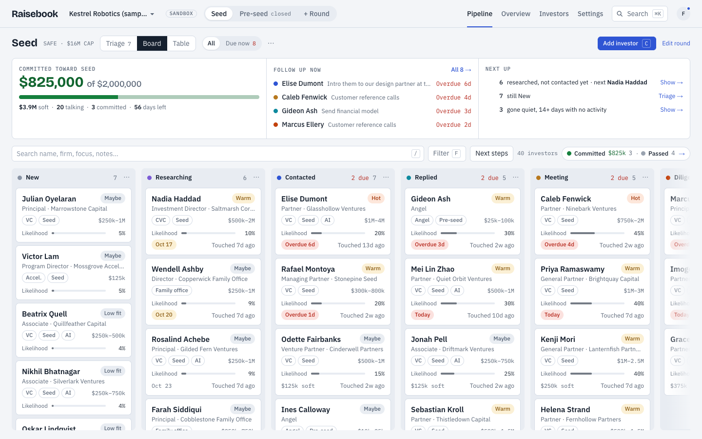

# Raisebook: the free, open-source investor CRM for founders

**Raisebook is a free, open-source investor CRM (fundraising CRM) for startup founders.** It
tracks every investor through every round (stages, fit, follow-ups, meetings, notes and
commitments) and ships an MCP server, so Claude Code, Codex, Cursor or any MCP client can work
the pipeline with you.

**[Start your raise at raisebook.org](https://raisebook.org)**, free, or self-host it.
Licensed under AGPL-3.0. [Pricing](https://raisebook.org/pricing) ·
[Docs](https://raisebook.org/docs) · [Compare](https://raisebook.org/compare) ·
[FAQ](https://raisebook.org/faq) · [llms.txt](https://raisebook.org/llms.txt)



## Who it's for

Founders raising a pre-seed, seed or Series A round who have outgrown the investor
spreadsheet: solo founders and small founding teams who want an investor pipeline with
follow-ups and meetings, do not want to pay per seat, and do not want their investor list
pooled into someone else's database. It also suits founders who work with an AI coding agent
and want it to log calls and set follow-ups for them.

It is not an investor database (you bring your list), it never emails investors for you, and
it is built for founders raising money, not for VC firms managing deal flow.

## Free forever

Raisebook costs $0, and that will not change.

- There is no paid tier, no seat price and no feature behind a paywall. Every workspace gets
  every feature, with the same limits.
- The maintainer pays the running costs today. Donations, once they open, will be optional;
  they will pay for hosting and never buy features, priority or a different deal on your data.
- The code is AGPL-3.0, so anyone who runs a modified copy as a service has to publish their
  changes. A hosted fork cannot quietly turn into a closed, paid product.

## The privacy promise

1. **Your data is yours.** A workspace is visible only to its members and to the API keys its
   owners create.
2. **We never pool, sell, rent or mine it.** Raisebook never builds an investor database from
   your data and never shows one workspace's data to another.
3. **No ads, no trackers.** No analytics scripts, pixels or third-party cookies. Fonts are
   served by Raisebook.
4. **No AI on your data unless you bring it.** Raisebook never runs or pays for AI on its
   own. Investor research runs only when you press a button, on your own OpenRouter key, and
   sends only the investor's name, firm and links, your company profile and round terms.
   Agents you connect use your key, and every action they take is on the timeline.
5. **Leave any time.** Export everything as CSV and JSON. Delete your workspace or account
   permanently, effective immediately.
6. **Check our work.** Raisebook is open source under AGPL-3.0, including the code that
   handles your data.

The details are on [raisebook.org/privacy](https://raisebook.org/privacy).

## What it does

- **Rounds** with a target, instrument (SAFE, priced, convertible note), cap or pre-money,
  target close date, and stages you can rename, recolor and reorder.
- **A pipeline page** with three views: **Triage** to decide on new investors one at a time
  (number keys, undo), a kanban **Board** you can drag (or drive with Alt+← / Alt+→), and a
  sortable, filterable **Table**. Above them, a ledger strip with committed against target,
  the funnel and due follow-ups; beside them, an investor sheet with the full timeline.
- **Investor contacts** shared across rounds, with dedupe on email, LinkedIn, name + firm
  and (when it is unambiguous) the name alone. An agent adding someone you already have fills
  in what is missing instead of creating a duplicate or dropping its notes.
- **An append-only timeline** that records who did what, people and agents alike. Agent
  actions are marked in their own color, with the agent's name and model.
- **Co-founders and advisors** as owners, editors and viewers. Sign in with an emailed link
  or with Google.
- **Meetings**: schedule them from an investor's file (it moves them to Meeting), see today's
  on Today and on board cards, record the outcome and next step when they are done, and
  subscribe to all of them from Google, Apple or Outlook Calendar with a private feed URL.
- **A sample workspace** with fictional investors, to try everything before your own data.
- **CSV import** with column mapping, preview and dedupe. **CSV and JSON export** of a round,
  all investors or the whole workspace. Hard delete of anything, at any time.
- **Investor research**: on demand and on your own OpenRouter key, a short dossier per
  investor (recent deals, thesis, a way in, an opener, a risk) where every fact cites a
  source, with a monthly spend limit per workspace and no markup. Agents can save their own
  research with `save_dossier`.
- **A phone layout** for the pipeline, board and triage.
- **A REST API** under `/v1` and **an MCP server** at `/mcp` with 21 tools, 26 with research
  enabled (no deletes).

Limits per workspace, the same for everyone: 50 rounds, 20,000 investors, 20 members,
20 API keys.

## How it compares

From each product's public pricing page on 2026-10-15; sources and details on
[raisebook.org/compare](https://raisebook.org/compare).

| | Lowest paid price | Free plan | Open source | MCP server |
|---|---|---|---|---|
| **Raisebook** | $0, no paid tier | Everything: 50 rounds, 20,000 investors, 20 members | Yes (AGPL-3.0) | Yes, free plan |
| Foundersuite | $745/yr (Silver) | Basic: 75 investors per pipeline | No | Not listed |
| Visible | $59/mo (Base, annual) | Starter: 2 pipelines, 100 update recipients | No | Yes |
| Affinity | $2,000/user/yr | None listed | No | Not checked |
| Attio | $35/seat/mo (Plus, annual) | Up to 3 seats | No | Yes |
| folk | $24/member/mo (annual) | 14-day trial | No | Yes |

Foundersuite includes an investor database, Visible adds investor updates and data rooms,
Affinity is built for VC firms, and Attio and folk are general CRMs. Raisebook does the
investor pipeline only, free and open source.

## Connect your agent (MCP quickstart)

Create a key in Settings → Connect an agent (it is shown once), then:

```bash
claude mcp add --transport http raisebook \
  https://api.raisebook.org/mcp \
  --header "Authorization: Bearer rb_live_XXXX" \
  --header "X-Agent-Name: claude-code"
```

Keep the default (local) scope or use `--scope user`. Never use `--scope project` with a
literal key: that writes it to a shared `.mcp.json`. An optional
`--header "X-Agent-Model: <model>"` shows the model next to the agent's name on the timeline.

Codex (`~/.codex/config.toml`):

```toml
[mcp_servers.raisebook]
url = "https://api.raisebook.org/mcp"
bearer_token_env_var = "RAISEBOOK_API_KEY"
http_headers = { "X-Agent-Name" = "codex" }
```

Then `export RAISEBOOK_API_KEY=rb_live_…` in the shell that starts Codex.

Cursor (`~/.cursor/mcp.json`; start Cursor from a terminal so it sees `RAISEBOOK_API_KEY`):

```json
{
  "mcpServers": {
    "raisebook": {
      "url": "https://api.raisebook.org/mcp",
      "headers": {
        "Authorization": "Bearer ${env:RAISEBOOK_API_KEY}",
        "X-Agent-Name": "cursor"
      }
    }
  }
}
```

Then ask: "What follow-ups are due this week in Seed?" or "Add these five investors from my
notes to Seed and remind me Friday." The agent starts with `get_workspace`, can create a
round (`create_round`), add up to 50 investors at once (`add_investors`) and set follow-ups
in the same call. A read-only key only sees the read tools. Setup for other clients and the
full tool reference: [raisebook.org/docs/mcp](https://raisebook.org/docs/mcp).

## Quick start (development)

You need Python 3.12 with [uv](https://docs.astral.sh/uv/), Node 20.9+, and Postgres 17 on
localhost with `raisebook_dev` and `raisebook_test` databases (extensions `citext` and
`pg_trgm`).

```bash
# API and MCP server on :8000
cd backend
uv sync
RAISEBOOK_DATABASE_URL=postgresql://localhost/raisebook_dev uv run alembic upgrade head
RAISEBOOK_ENV=dev uv run uvicorn --factory raisebook.main:create_app --reload

# Web app on :3000 (another terminal)
cd web
npm ci
npm run dev
```

Open http://localhost:3000/signin and request a link. In development the "check your inbox"
page shows the link, so you do not need email. For a workspace full of fictional investors:

```bash
cd backend && uv run rbctl seed-demo --email you@example.com
```

Checks:

```bash
cd backend && uv run pytest -q && uv run ruff check . && uv run ruff format --check . && uv run mypy raisebook
cd web && npm run lint && npm run typecheck && npm run build
```

## Self-hosting

One Docker Compose file runs Postgres, the API, the web app and Caddy for TLS:

```bash
cp deploy/.env.example deploy/.env   # set your hosts and secrets
docker compose -f deploy/docker-compose.yml up -d --build
```

Step by step: [raisebook.org/docs/self-hosting](https://raisebook.org/docs/self-hosting),
[`docs/DEPLOY.md`](docs/DEPLOY.md) and the trust boundaries in
[`deploy/README.md`](deploy/README.md): never expose the API port directly with
`FORWARDED_ALLOW_IPS=*`, and keep every subdomain of your cookie domain first-party.
Run `rbctl housekeeping` daily; it deletes expired sign-in requests, sessions and dead invites.

## Repository

| Path | What |
|---|---|
| `backend/` | FastAPI, SQLAlchemy 2 (async), Alembic, Postgres 17. REST under `/v1`, MCP at `/mcp`. |
| `web/` | Next.js 15, React 19, Tailwind v4. The app, the site and the docs. |
| `deploy/` | Dockerfiles, `docker-compose.yml`, `Caddyfile`, backup script. |
| `docs/SPEC.md` | The product and engineering spec. |
| `design/SYSTEM.md` | The design system. |

## Contributing

Issues and pull requests are welcome. Read [CONTRIBUTING.md](CONTRIBUTING.md) first, and
[SECURITY.md](SECURITY.md) to report a vulnerability. Everyone taking part follows the
[Code of Conduct](CODE_OF_CONDUCT.md).

## License

Copyright (C) 2026 Zhirayr Gumruyan and Raisebook contributors.

Raisebook is free software: you can redistribute it and/or modify it under the terms of the
GNU Affero General Public License as published by the Free Software Foundation, version 3.
It is distributed in the hope that it will be useful, but without any warranty; without even
the implied warranty of merchantability or fitness for a particular purpose. See
[LICENSE](LICENSE) for the full text.
